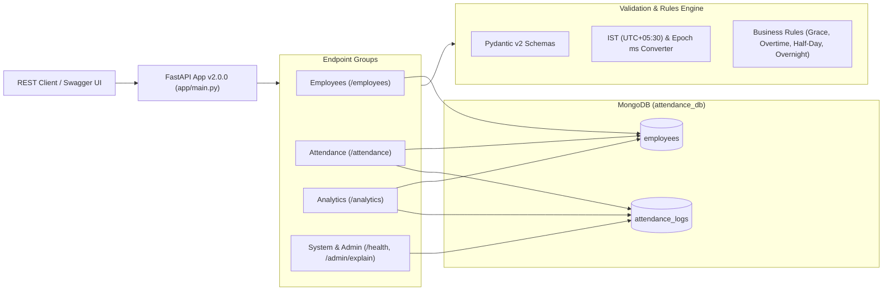
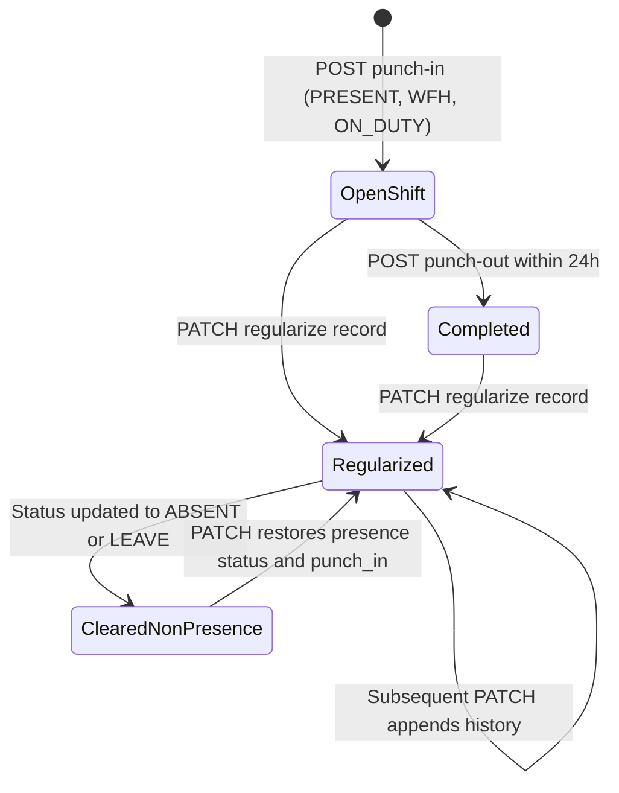
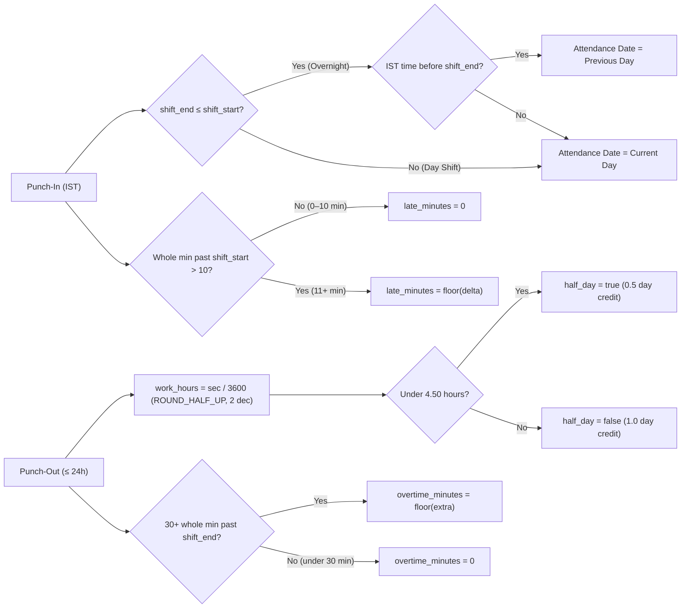
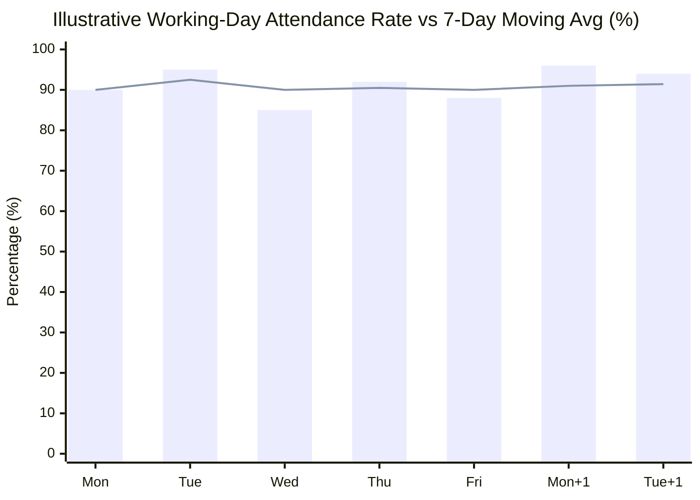
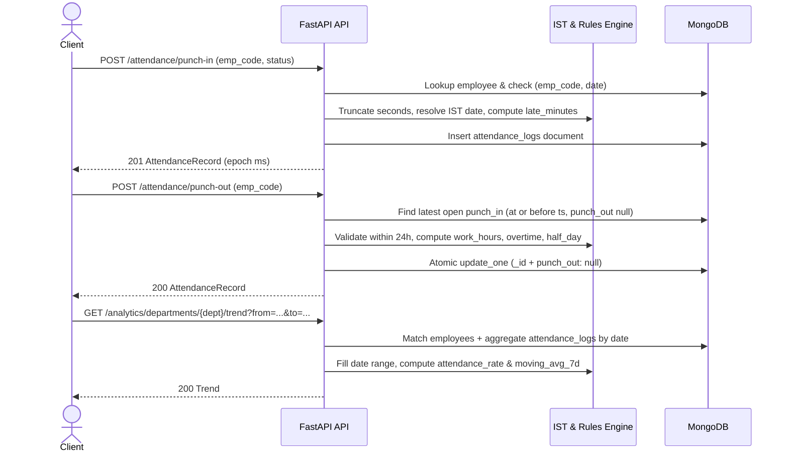
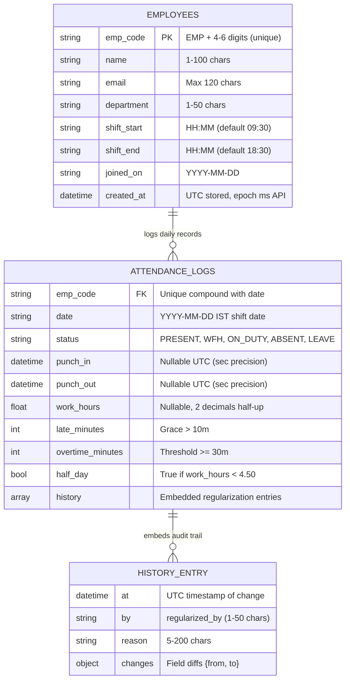

<div align="left">

# Employee Attendance & Analytics API


**A FastAPI for shift-aware attendance tracking, audit-trailed manual regularization, and workforce analytics.**

---

</div>

## Overview

The **Employee Attendance & Analytics API** (`v2.0.0`) manages employee shift profiles, real-time punch-in/punch-out workflows (including overnight shifts), concurrency-safe updates, manual attendance regularizations with immutable field-level audit trails, and MongoDB aggregation-based workforce analytics.

### Key Capabilities

| Capability | Description | Implementation Highlight |
| :--- | :--- | :--- |
| **Shift & Overnight Support** | Tracks custom `HH:MM` shifts per employee | Overnight punches before `shift_end` map to the previous shift date |
| **Automated Rule Engine** | Computes `late_minutes`, `work_hours`, `overtime_minutes`, `half_day` | Enforces grace windows, half-up `Decimal` rounding, and 24-hour caps |
| **Concurrency Safety** | Prevents duplicate punches and race-condition punch-outs | Unique compound index `(emp_code, date)` + atomic `punch_out: null` filter |
| **Audit-Trailed Regularization** | Corrects historical status or punch timestamps | Appends `{at, by, reason, changes}` diffs into `history[]` |
| **Aggregation Analytics** | Monthly employee/department rollups, leaderboard, 7-day trend | MongoDB `$match` / `$group` / `$lookup` pipelines + working-day rules |
| **Query Observability** | Inspects MongoDB query plans directly via API | `/admin/explain/{endpoint}` exposes `.explain()` diagnostics |

### Project Structure & Tech Stack

| Component | Minimum Spec (`requirements.txt`) | Verified Runtime | Purpose |
| :--- | :--- | :--- | :--- |
| **Python** | — | `3.14.6` | Core runtime (`app/main.py`) |
| **FastAPI** | `fastapi>=0.110` | `0.143.0` | REST routing, OpenAPI docs (`/docs`), dependency validation |
| **Uvicorn** | `uvicorn[standard]>=0.29` | `0.54.0` | ASGI HTTP server |
| **PyMongo** | `pymongo[srv]>=4.7` | `4.18.3` | Synchronous MongoDB driver & aggregation execution |
| **Pydantic** | `pydantic>=2.6` | `2.14.0` | Request/response schemas & custom field validators |
| **python-dotenv** | `python-dotenv>=1.0` | `1.2.4` | Loads `MONGO_URI` and `MONGO_DB` from `.env` |
| **MongoDB** | — | `7.0` | Document store (`employees` & `attendance_logs`) |

```text
Employee Attendance & Analytics API/
├── app/
│   ├── __init__.py
│   └── main.py           # FastAPI app, constants, helpers, Pydantic models, indexes, and 12 routes
├── requirements.txt      # Python dependency constraints
└── README.md             # Project documentation
```

---

## Architecture



> [!IMPORTANT]
> **Three-Zone Timestamp Model:**
> - **API Requests & Responses** use integer **epoch milliseconds** validated within `[100000000000, 4102444800000]` (Jan 1, 1973 – Jan 1, 2100) to reject second-precision inputs.
> - **MongoDB Storage** persists `punch_in` and `punch_out` as **UTC `datetime`** truncated to whole seconds (`microsecond=0`), plus UTC `created_at` and `history[].at`.
> - **Business Logic** converts timestamps to **IST (`UTC+05:30`)** for shift dates, late grace checks, overtime thresholds, and `Mon–Fri` working-day evaluation.

---

## Classifications & Business Rules

### 1. Attendance Status Classification

The API strictly separates **Presence Statuses** (`PRESENCE_STATUS_VALUES`) from **Non-Presence Statuses**:

| Status | Classification Group | Allowed at `punch-in` | Allowed at `PATCH` Regularize | `punch_in` / `punch_out` Policy | Analytics Treatment |
| :--- | :--- | :---: | :---: | :--- | :--- |
| `PRESENT` | Presence (`PRESENCE_STATUS_VALUES`) | Yes | Yes | Requires `punch_in` | Counts as `1.0` present day (`0.5` if `half_day: true`) on Mon–Fri |
| `WFH` | Presence (`PRESENCE_STATUS_VALUES`) | Yes | Yes | Requires `punch_in` | Counts as `1.0` present day (`0.5` if `half_day: true`) on Mon–Fri |
| `ON_DUTY` | Presence (`PRESENCE_STATUS_VALUES`) | Yes | Yes | Requires `punch_in` | Counts as `1.0` / `0.5` present day on Mon–Fri + tracked in `on_duty_count` |
| `ABSENT` | Non-Presence (`STATUS_VALUES`) | No (`422`) | Yes | Clears `punch_in` & `punch_out` (`null`); cannot send punches | Resets `late_minutes=0`, `work_hours=null`, `overtime_minutes=0`, `half_day=false` |
| `LEAVE` | Non-Presence (`STATUS_VALUES`) | No (`422`) | Yes | Clears `punch_in` & `punch_out` (`null`); cannot send punches | Resets derived fields; counted in `leave_days` / `leave_count` |

### 2. Attendance Record Lifecycle



### 3. Shift Evaluation & Thresholds



### 4. Business Rules & Validation Constants Matrix

| Rule / Constant | Value / Formula | Applied In | Edge-Case Behavior |
| :--- | :--- | :--- | :--- |
| **Second Truncation (`R1`)** | `dt.replace(microsecond=0)` | `punch-in`, `punch-out`, `regularize` | Microseconds are discarded prior to comparisons and storage |
| **Overnight Date Mapping (`R1`)** | `shift_end <= shift_start` | `punch-in`, `regularize` | Punches before `shift_end` (IST) belong to the previous calendar date; `calculate_shift_end_datetime` advances `shift_end` by `+1 day` when `hour < 12` |
| **Late Grace Window (`R2`)** | `GRACE_MINUTES = 10` | `punch-in`, `regularize` | Strictly `> 10` whole minutes late (`floor(delta / 60)`); `10:59` past `shift_start` is `10` whole min -> `0` late minutes |
| **Overtime Threshold (`R3`)** | `OVERTIME_THRESHOLD_MINUTES = 30` | `punch-out`, `regularize` | Counted only when whole minutes past `shift_end` are `>= 30` |
| **Work Hours (`R4`)** | `(punch_out - punch_in) / 3600` | `punch-out`, `regularize` | Rounded to `2` decimals using `Decimal.quantize('0.01', ROUND_HALF_UP)` |
| **Half-Day Rule (`R5`)** | `HALF_DAY_HOURS = 4.50` | `punch-out`, `regularize`, analytics | `half_day = true` when rounded `work_hours < 4.50`; contributes `0.5` to `present_days` / `present_count` |
| **Working Days (`R6–R7`)** | Monday–Friday (`weekday() < 5`) | `employee_monthly`, `department_summary`, `department_trend` | Monthly `working_days` starts at `max(joined_on, first_day_of_month)` |
| **Half-Up Rounding (`R8`)** | `ROUND_HALF_UP` | Analytics | `2` decimals for `present_days`, `attendance_pct`, `avg_work_hours`; `4` decimals for `attendance_rate`, `moving_avg_7d` |
| **Headcount Cutoff (`R9`)** | `joined_on <= target_date` | `department_summary`, `department_trend` | Includes employees joined on or before month-end (summary) or day `date` (trend) |
| **Max Shift Span** | `24 * 3600` seconds | `punch-out`, `regularize` | Rejects `punch_out <= punch_in` or `> 24h` after `punch_in` (`422`) |
| **Epoch Bounds** | `100000000000` .. `4102444800000` | All epoch inputs | Rejects timestamps outside `1973-01-01` .. `2100-01-01` (`422`) |

---

## API Reference

Interactive OpenAPI documentation is automatically served at `/docs` (Swagger UI) and `/redoc` when the server is running.

### Endpoints Classification Matrix

| Group | Method | Path | Summary | Status |
| :--- | :--- | :--- | :--- | :---: |
| **System** | `GET` | `/health` | Readiness probe (`ping` MongoDB) | `200` / `503` |
| **Employees** | `POST` | `/employees` | Register employee with shift schedule | `201` |
| **Employees** | `GET` | `/employees` | Paginated employee directory (`emp_code` asc) | `200` |
| **Attendance** | `POST` | `/attendance/punch-in` | Open daily attendance record & compute `late_minutes` | `201` |
| **Attendance** | `POST` | `/attendance/punch-out` | Close latest open punch-in & compute hours/overtime/half-day | `200` |
| **Attendance** | `GET` | `/attendance` | Filter & paginate attendance logs (`date` desc, `emp_code` asc) | `200` |
| **Attendance** | `PATCH` | `/attendance/{emp_code}/{date}` | Regularize record, recompute derived fields, append `history[]` | `200` |
| **Analytics** | `GET` | `/analytics/employees/{emp_code}/monthly` | Monthly attendance rollup & percentage for one employee | `200` |
| **Analytics** | `GET` | `/analytics/departments/summary` | Monthly department-level headcount, hours, late & leave counts | `200` |
| **Analytics** | `GET` | `/analytics/leaderboard/late` | Ranked monthly late-comers leaderboard (`limit` `1..50`) | `200` |
| **Analytics** | `GET` | `/analytics/departments/{department}/trend` | Daily trend (`<= 92` days) with 7-day working-day moving avg | `200` |
| **Admin** | `GET` | `/admin/explain/{endpoint}` | MongoDB `.explain()` query plan for key endpoints | `200` |

### Endpoint Specifications & Interactive Payloads

<details>
<summary><strong>1. System &amp; Admin Endpoints</strong> — <code>GET /health</code>, <code>GET /admin/explain/{endpoint}</code></summary>

#### `GET /health`
Verifies connectivity using `client.admin.command('ping')`. Returns `{"status": "ok"}` (`200`) or `503` (`"MongoDB not responding"`).

#### `GET /admin/explain/{endpoint}`
Runs `.explain()` on the target `attendance_logs` query or aggregation pipeline.

| `{endpoint}` Slug | Required Query Params | Optional Query Params | Execution Mode |
| :--- | :--- | :--- | :--- |
| `attendance_list` | None | `emp_code`, `date_from`, `date_to`, `status` | `find(query).explain()` |
| `employee_monthly` | `emp_code`, `month` | — | `aggregate(pipeline, explain=True)` |
| `department_summary` | `month` | `department` | `aggregate(pipeline, explain=True)` |
| `late_leaderboard` | `month` | — | `aggregate(pipeline, explain=True)` |
| `department_trend` | `from`, `to` | — | `aggregate(pipeline, explain=True)` |

</details>

<details>
<summary><strong>2. Employee Management</strong> — <code>POST /employees</code>, <code>GET /employees</code></summary>

#### `POST /employees` — Field Constraints

| Field | Type | Validation / Default |
| :--- | :--- | :--- |
| `emp_code` | `string` | Required; regex `^EMP\d{4,6}$` (unique) |
| `name` | `string` | Required; `1..100` chars |
| `email` | `string` | Required; max `120` chars, regex `^[^@\s]+@[^@\s]+\.[^@\s]+$` |
| `department` | `string` | Required; `1..50` chars |
| `shift_start` | `string` | Optional; default `"09:30"`, `HH:MM` (`00:00`–`23:59`) |
| `shift_end` | `string` | Optional; default `"18:30"`, `HH:MM`, must differ from `shift_start` |
| `joined_on` | `string` | Required; ISO date `YYYY-MM-DD` |

**Sample `POST /employees` Request:**

```json
{
  "emp_code": "EMP0001",
  "name": "Aarav Sharma",
  "email": "aarav.sharma@example.com",
  "department": "Engineering",
  "shift_start": "09:30",
  "shift_end": "18:30",
  "joined_on": "2026-01-05"
}
```

#### `GET /employees` — Query Parameters

| Param | Default | Constraints | Description |
| :--- | :--- | :--- | :--- |
| `department` | `null` | Optional string | Exact department filter |
| `page` | `1` | `>= 1` | 1-based page index |
| `page_size` | `20` | `1..100` | Records per page (sorted by `emp_code` asc) |

</details>

<details>
<summary><strong>3. Attendance Operations</strong> — <code>punch-in</code>, <code>punch-out</code>, <code>list</code>, <code>regularize</code></summary>

#### `POST /attendance/punch-in`
- `emp_code` (required), `punched_at` (optional epoch ms, defaults to current UTC time), `status` (default `"PRESENT"`, must be in `["PRESENT", "WFH", "ON_DUTY"]`).
- Returns `404` if employee does not exist; `409` if already punched in on the computed IST shift date.

#### `POST /attendance/punch-out`
- `emp_code` (required), `punched_at` (optional epoch ms, defaults to current UTC time).
- Matches the most recent open record (`punch_in <= ts`, `punch_out: null`) sorted by `punch_in` descending.
- Uses an atomic update condition `{"_id": record["_id"], "punch_out": None}` to prevent double punch-out races (`409`).

#### `GET /attendance`
- Query params: `emp_code`, `date_from`, `date_to`, `status`, `page` (`>= 1`, default `1`), `page_size` (`1..100`, default `20`).
- Rejects `date_from > date_to` with `422`. Sorted by `date` desc, `emp_code` asc.

#### `PATCH /attendance/{emp_code}/{date}` — Regularize Record
- Body requires `reason` (`5..200` chars) and `regularized_by` (`1..50` chars), plus at least one effective change among `status`, `punch_in`, or `punch_out`.
- Recomputes `late_minutes`, `work_hours`, `overtime_minutes`, and `half_day`, then appends an immutable entry to `history[]` (example below sets `2026-01-15` `09:30–18:30 IST` for `EMP0001`):

```json
{
  "status": "PRESENT",
  "punch_in": 1768449600000,
  "punch_out": 1768482000000,
  "reason": "Biometric terminal sync delay on morning arrival",
  "regularized_by": "HR_ADMIN"
}
```

</details>

<details>
<summary><strong>4. Analytics Endpoints</strong> — Monthly, Department Summary, Leaderboard, Daily Trend</summary>

| Endpoint | Required Params | Optional Params | Notes |
| :--- | :--- | :--- | :--- |
| `GET /analytics/employees/{emp_code}/monthly` | `month` (`YYYY-MM`) | — | `404` if `emp_code` not found |
| `GET /analytics/departments/summary` | `month` (`YYYY-MM`) | `department` | Sorted by `department` asc; omits departments with `headcount == 0` |
| `GET /analytics/leaderboard/late` | `month` (`YYYY-MM`) | `limit` (`1..50`, default `10`), `department` | Sorted by `total_late_minutes` desc, `_id` (`emp_code`) asc; filtered by `rank <= limit` |
| `GET /analytics/departments/{department}/trend` | `from`, `to` (`YYYY-MM-DD`) | — | `404` if department missing; `422` if `to < from` or span `> 92` days |

</details>

### HTTP Status & Error Classification

| Status Code | Meaning | Triggered Conditions |
| :---: | :--- | :--- |
| **`200`** | OK | Successful `GET`, `punch-out`, `PATCH` regularization, or `/health` probe |
| **`201`** | Created | Successful `POST /employees` or `POST /attendance/punch-in` |
| **`404`** | Not Found | Employee missing, no open punch-in found, attendance record missing, or unknown department |
| **`409`** | Conflict | Duplicate `emp_code`, duplicate `(emp_code, date)` punch-in, or concurrent/duplicate punch-out |
| **`422`** | Unprocessable Entity | Invalid regex/ranges, `shift_end == shift_start`, invalid status, `date_from > date_to`, `> 92`-day trend, `> 24h` shift, or no-op regularization |
| **`503`** | Service Unavailable | MongoDB unreachable during `/health` check |

---

## Analytics & Visualizations

### Analytics Metrics Classification

| Metric / Endpoint | Granularity | Working-Day Filter | Half-Day Weight | Precision (`ROUND_HALF_UP`) |
| :--- | :--- | :--- | :---: | :--- |
| `EmployeeMonthly` | Employee × Month | `Mon–Fri` from `max(joined_on, month_start)` | `0.5` | `2` decimals (`present_days`, `attendance_pct`) |
| `DepartmentSummary` | Department × Month | `Mon–Fri` for `present_days`; all logs for `avg_work_hours`, `late_count`, `leave_count`, `on_duty_count` | `0.5` | `2` decimals (`present_days`, `avg_work_hours`) |
| `Leaderboard` | Employee × Month (`late_minutes > 0`) | Includes all logs in month with `late_minutes > 0` | N/A | Integer (`total_late_minutes`, `late_count`, `rank`) |
| `Trend` | Department × Calendar Day (`<= 92` days) | `attendance_rate` computed only when `is_working_day && headcount > 0` (else `null`) | `0.5` | `2` decimals (`present_count`); `4` decimals (`attendance_rate`, `moving_avg_7d`) |

### Illustrative 7-Day Department Trend (`GET /analytics/departments/{department}/trend`)

The chart below illustrates how `attendance_rate` (bars) and `moving_avg_7d` (line) behave across consecutive working days (`Mon–Fri`). On weekend dates (`is_working_day: false`), the API returns `attendance_rate: null` while carrying forward `moving_avg_7d` from the trailing 7 working-day rates.



### End-to-End Punch-to-Analytics Sequence



---

## Database & Indexing

### Data Model



### Startup Indexes Classification

All indexes are created idempotently on FastAPI startup (`@app.on_event("startup")`). If MongoDB is unavailable at boot, the app logs a warning and continues running.

| Collection | Index Keys | Constraint | Queries Accelerated |
| :--- | :--- | :---: | :--- |
| `employees` | `[("emp_code", ASCENDING)]` | `unique: true` | Employee lookups, duplicate `emp_code` prevention (`409`), `$lookup` joins |
| `attendance_logs` | `[("emp_code", ASCENDING), ("date", ASCENDING)]` | `unique: true` | Single-day record lookups, duplicate punch-in guard (`409`), monthly employee queries |
| `attendance_logs` | `[("date", DESCENDING)]` | — | `/attendance` default sorting (`date` desc) & date-range scans |
| `attendance_logs` | `[("status", ASCENDING)]` | — | Status filtering (`?status=...`) |
| `attendance_logs` | `[("date", ASCENDING), ("status", ASCENDING)]` | — | Monthly analytics pipelines & date + status aggregations |

---

## Setup & Quick Start

### 1. Environment Variables

| Variable | Default | Description |
| :--- | :--- | :--- |
| `MONGO_URI` | `mongodb://localhost:27017` | MongoDB connection string |
| `MONGO_DB` | `attendance_db` | Target MongoDB database name |

### 2. Install & Run

```bash
# 1. Create and activate virtual environment
python -m venv .venv
.venv\Scripts\activate      # Windows PowerShell / CMD
# source .venv/bin/activate # Linux / macOS

# 2. Install dependencies
pip install -r requirements.txt

# 3. Configure environment (optional if using local defaults)
# Create .env with MONGO_URI and MONGO_DB

# 4. Start the API server
uvicorn app.main:app --port 8000
```

Once started, browse to `http://localhost:8000/docs` for interactive Swagger UI testing or `http://localhost:8000/health` for MongoDB readiness.

<details>
<summary><strong>Interactive Smoke-Test Walkthrough (cURL)</strong> — Create employee, punch in/out, regularize, and query analytics</summary>

```bash
# 1. Check API & MongoDB readiness
curl http://localhost:8000/health

# 2. Register an employee
curl -X POST http://localhost:8000/employees \
  -H "Content-Type: application/json" \
  -d '{
    "emp_code": "EMP0001",
    "name": "Aarav Sharma",
    "email": "aarav.sharma@example.com",
    "department": "Engineering",
    "shift_start": "09:30",
    "shift_end": "18:30",
    "joined_on": "2026-01-05"
  }'

# 3. Record a punch-in (uses current time when punched_at is omitted)
curl -X POST http://localhost:8000/attendance/punch-in \
  -H "Content-Type: application/json" \
  -d '{"emp_code": "EMP0001", "status": "PRESENT"}'

# 4. Record a punch-out
curl -X POST http://localhost:8000/attendance/punch-out \
  -H "Content-Type: application/json" \
  -d '{"emp_code": "EMP0001"}'

# 5. Regularize a historical record (e.g., 2026-01-15 09:30-18:30 IST)
curl -X PATCH http://localhost:8000/attendance/EMP0001/2026-01-15 \
  -H "Content-Type: application/json" \
  -d '{
    "status": "PRESENT",
    "punch_in": 1768449600000,
    "punch_out": 1768482000000,
    "reason": "Biometric terminal sync delay on morning arrival",
    "regularized_by": "HR_ADMIN"
  }'

# 6. Query monthly analytics
curl "http://localhost:8000/analytics/employees/EMP0001/monthly?month=2026-01"

# 7. Inspect MongoDB query plan
curl "http://localhost:8000/admin/explain/employee_monthly?emp_code=EMP0001&month=2026-01"
```

</details>

---

## License

This project is licensed under the **MIT License** — see the [LICENSE](LICENSE) file for full details.

| Attribute | Details |
| :--- | :--- |
| **License Type** | MIT License |
| **Permissions** | Commercial use, modification, distribution, private use |
| **Conditions** | Include original copyright notice and license text |
| **Limitations** | Provided "as is", without warranty or liability |

---

## Contact Information

### Madhan Mohan Reddy

- **Email**: <madhanmohanreddyperam06@gmail.com>
- **Mobile**: +91 9110395993

---
<div align="center">
© 2026 Campus Finder. All rights reserved.
</div>
